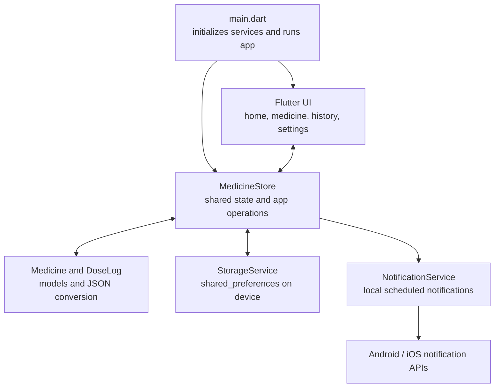

# MedCare

MedCare is a Flutter medicine reminder app designed to make daily medication routines easier to follow. It provides a clear daily schedule, large and easy-to-read controls, and a simple way to track doses.

## Features

- Add and edit medicines with dosage, form, notes, and one or more daily reminder times.
- View today's dose schedule and mark each dose as taken or skipped.
- Undo a dose status if it was selected by mistake.
- Review dose history and adherence, with filters for taken and skipped doses.
- Pause or resume reminders for an individual medicine.
- Set a display name, enable or disable reminders, and choose a snooze length.

### Developer setup

- Flutter SDK with Dart SDK `^3.13.2` support.
- Git.
- For Android: Android Studio (or Android SDK command-line tools), with an emulator configured or a device connected.
- For iOS: macOS with Xcode installed and an iOS simulator or device. iOS builds cannot be produced on Windows or Linux.

If Flutter is not installed, follow the [official Flutter installation guide](https://docs.flutter.dev/get-started/install) for your operating system and add the Flutter `bin` directory to your `PATH`. Install Android Studio and its Android SDK tools for Android development; on macOS, install Xcode for iOS development.

Verify the SDK and platform tool setup:

```shell
flutter doctor
flutter --version
```

For Android, accept the Android SDK licenses if `flutter doctor` requests it:

```shell
flutter doctor --android-licenses
```

### Run the app locally

Clone the repository and enter its directory:

```shell
git clone https://github.com/n4vss/Medicine-Reminder-App.git
cd Medicine-Reminder-App
```

Fetch Dart and Flutter dependencies:

```shell
flutter pub get
```

Start an emulator or connect a device, then list available targets and run the app:

```shell
flutter devices
flutter run
```

To select a particular target:

```shell
flutter run -d <device-id>
```

On Windows, if Flutter is not on your `PATH`, run the Flutter batch file directly from PowerShell:

```powershell
& 'C:\path\to\flutter\bin\flutter.bat' doctor
& 'C:\path\to\flutter\bin\flutter.bat' pub get
& 'C:\path\to\flutter\bin\flutter.bat' run
```

### Install and set up on a phone

The repository does not include a prebuilt installer. To build an Android release APK, run this from the project directory:

```shell
flutter build apk --release
```

The APK will be written to `build/app/outputs/flutter-apk/app-release.apk`. Transfer it to an Android device and install it, or connect the device and run:

```shell
flutter install
```

If installing the APK manually, Android may ask you to allow installation from the app you used to open the file. Only install APKs from a source you trust.

For iPhone or iPad, build on macOS with Xcode and valid Apple signing configured. Use Xcode to install on a development device, or distribute through an appropriate Apple distribution channel such as TestFlight; this repository does not provide an iOS installer.

On first launch:

1. Open **Settings** to optionally enter your name and confirm **Enable reminders** is on.
2. Add a medicine with its name, dosage, and at least one reminder time, then save it.
3. Allow notification permission when prompted. If notifications are blocked, enable them for MedCare in the device's system settings.
4. Remember that reminders are local to this device. Android may delay them due to battery policies; do not rely on reminders as guaranteed alerts or medical advice.

No backend service, API key, or additional environment file is required. Medicine details, preferences, and dose history are saved on the device and are removed if app data is cleared or the app is uninstalled.

## Run tests and analysis

```shell
flutter test
flutter analyze
```

## Architecture

The UI reads and changes app state through the singleton `MedicineStore`. The store restores and persists medicine, dose-history, and settings data through `StorageService`, and synchronizes active medicine reminders through `NotificationService`.



### Project structure

```text
lib/
  main.dart                  App entry point and shared theme
  models/medicine.dart       Medicine and dose data models
  screens/                   Home, medicine, history, and settings screens
  services/medicine_store.dart
                             Shared app state, restored and saved on-device
  services/storage_service.dart
                             Local medicine, settings, and dose-history storage
  services/notification_service.dart
                             Daily Android/iOS local notification scheduling
  utils.dart                 Date labels and navigation helper
test/
  widget_test.dart           Basic app and model tests
```
